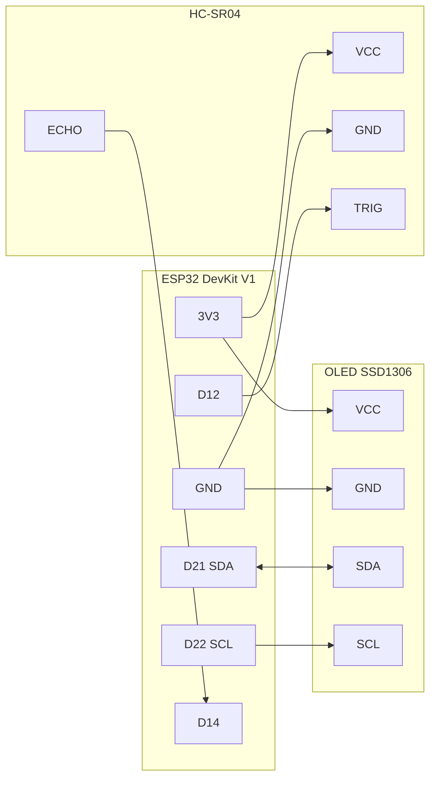
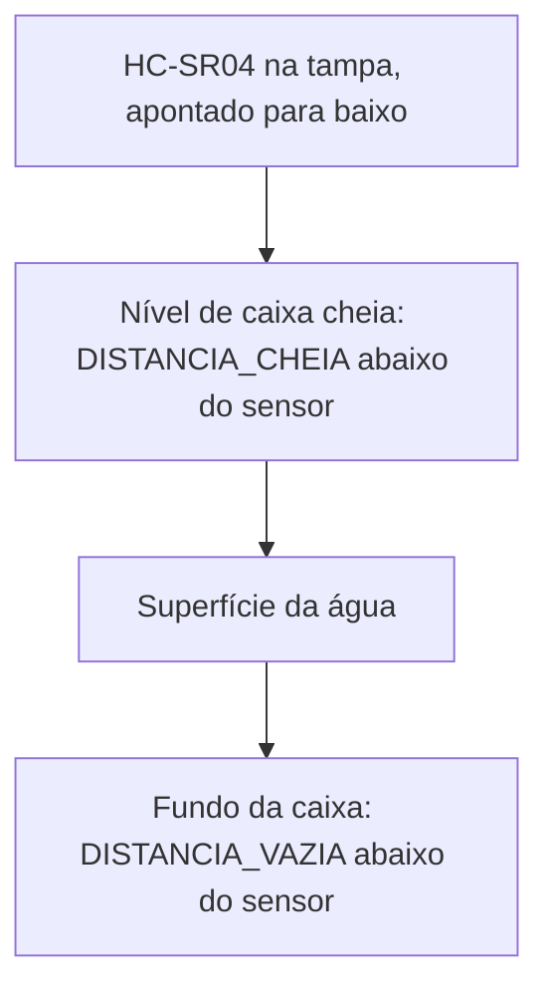
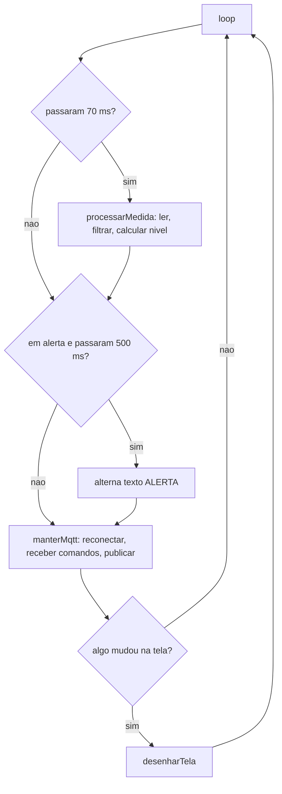
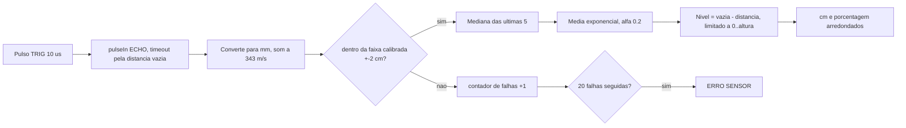
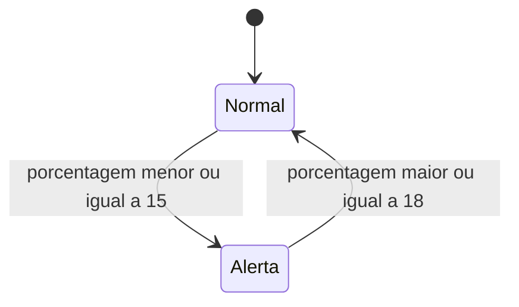
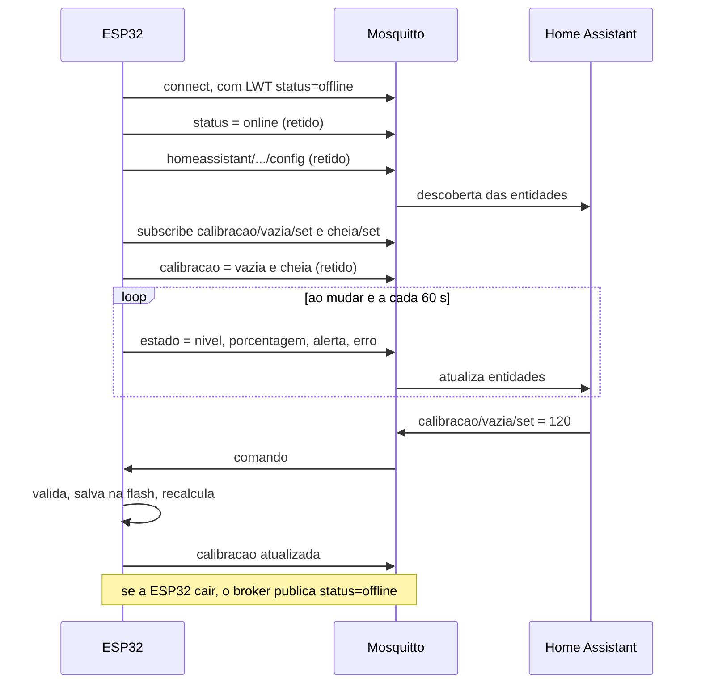

# Nível Caixa d'Água

Medidor de nível de caixa d'água com **ESP32**, sensor ultrassônico **HC-SR04** e display **OLED SSD1306**, integrado ao **Home Assistant** via **MQTT** com descoberta automática.

O nível é exibido localmente no display (em cm, em % e em um gráfico da caixa) e publicado no Home Assistant, onde também é possível **calibrar as distâncias de caixa cheia e vazia** sem regravar a firmware.

---

## Sumário

- [Funcionalidades](#funcionalidades)
- [Hardware](#hardware)
- [Ligações](#ligações)
- [Arquitetura do firmware](#arquitetura-do-firmware)
- [Processamento da medida](#processamento-da-medida)
- [Integração com o Home Assistant](#integração-com-o-home-assistant)
- [Instalação](#instalação)
- [Calibração](#calibração)
- [Simulação no Wokwi](#simulação-no-wokwi)
- [Parâmetros ajustáveis](#parâmetros-ajustáveis)
- [Solução de problemas](#solução-de-problemas)
- [Estrutura do repositório](#estrutura-do-repositório)
- [Limitações conhecidas e próximos passos](#limitações-conhecidas-e-próximos-passos)

---

## Funcionalidades

- **Medição estável**: filtro de mediana (5 amostras) seguido de média exponencial, com resolução em milímetros.
- **Rejeição de falso eco**: leituras fora da faixa calibrada são descartadas.
- **Detecção de falha do sensor**: após ~1,4 s sem leituras válidas, a tela mostra `ERRO SENSOR` e o Home Assistant é notificado.
- **Alerta de nível baixo com histerese**: liga em ≤ 15% e só desliga em ≥ 18%, sem ficar oscilando no limite.
- **Loop não bloqueante**: medição, tela e rede rodam em paralelo via `millis()`; a tela só é redesenhada quando algo muda.
- **Home Assistant via MQTT Discovery**: o dispositivo e suas entidades aparecem sozinhos, sem YAML.
- **Calibração remota**: distâncias de caixa cheia e vazia editáveis no Home Assistant e salvas na flash da ESP32.
- **Funciona offline**: sem Wi-Fi ou sem broker, a medição e o display continuam operando normalmente.
- **Simulação**: projeto pronto para rodar no [Wokwi](https://wokwi.com/) dentro do VS Code / Cursor.

---

## Hardware

| Componente | Observação |
|---|---|
| ESP32 DevKit V1 (30 pinos, DOIT) | Placa usada no projeto |
| Sensor ultrassônico HC-SR04 | Alimentado em 3,3 V (ideal: HC-SR04P ou RCWL-9610) |
| Display OLED SSD1306 128x64 I2C | Endereço 0x3C (0x3D também é detectado) |
| Fonte 5 V / cabo USB | Alimentação da ESP32 |

> **Sobre a tensão do sensor:** o ECHO do HC-SR04 sai com a mesma tensão de alimentação do sensor. Em 3,3 V ele pode ir direto ao GPIO. **Se alimentar o sensor em 5 V, é obrigatório um divisor resistivo no ECHO** (ex.: 1 kΩ em série + 2 kΩ para o GND), pois o ESP32 não tolera 5 V nos pinos.

---

## Ligações

| Componente | Pino do componente | Pino na ESP32 DevKit V1 |
|---|---|---|
| OLED | VCC | 3V3 |
| OLED | GND | GND |
| OLED | SDA | D21 |
| OLED | SCL | D22 |
| HC-SR04 | VCC | 3V3 |
| HC-SR04 | GND | GND |
| HC-SR04 | TRIG | D12 |
| HC-SR04 | ECHO | D14 |



> **GPIO12 é pino de strapping** do ESP32: se estiver em nível alto durante o boot, a placa pode não iniciar. Se isso acontecer, mova o TRIG para D25, D26 ou D27 e altere `PIN_TRIG` no código.

### Montagem na caixa



- **Distância vazia**: do sensor até o fundo (0% de água).
- **Distância cheia**: do sensor até a água com a caixa cheia (100%). Mantenha pelo menos ~5 cm, pois o HC-SR04 não mede bem a menos de 2 cm.
- Instale o sensor longe das paredes e da entrada de água, para evitar ecos falsos e turbulência.

---

## Arquitetura do firmware

O `loop()` nunca fica bloqueado por `delay()`. Cada tarefa roda no seu próprio intervalo:



| Tarefa | Intervalo | Função |
|---|---|---|
| Medição ultrassônica | 70 ms | `processarMedida()` |
| Pisca do alerta | 500 ms | `loop()` |
| Reconexão MQTT | 10 s (quando desconectado) | `manterMqtt()` |
| Publicação de estado | ao mudar (mín. 2 s) + a cada 60 s | `publicarEstado()` |
| Redesenho da tela | somente quando algo muda | `desenharTela()` |

### Tela OLED

```
+--------------------------------+
| HA      45 cm   (ou ALERTA!)   |  <- faixa superior (Y 0-15)
|   _____                        |
|  |     |                       |
|  |#####|      50%              |  <- gráfico da caixa + porcentagem
|  |#####|                       |
|  |_____|                       |
+--------------------------------+
```

- `HA` aparece no canto quando a conexão com o Home Assistant (MQTT) está ativa.
- Em nível baixo, o valor em cm alterna com `ALERTA!` a cada 500 ms.
- Em falha do sensor, a tela inteira mostra `ERRO SENSOR`.

---

## Processamento da medida



- **Mediana**: elimina picos isolados (ondulação, eco nas paredes) que ainda caem dentro da faixa válida.
- **Média exponencial**: suaviza a variação restante. Constante de tempo de ~350 ms (`ALFA_EMA = 0.2` a cada 70 ms).
- **Inicialização**: o filtro começa com a primeira leitura válida, então a tela já mostra o nível correto no boot.

### Alerta com histerese



---

## Integração com o Home Assistant

A ESP32 se conecta ao Wi-Fi e ao broker MQTT (add-on **Mosquitto**). Ao conectar, publica as mensagens de descoberta, e o Home Assistant cria o dispositivo automaticamente.



### Entidades criadas

Dispositivo: **Nível Caixa d'Água**

| Entidade | Tipo | Unidade | Categoria |
|---|---|---|---|
| Nível | `sensor` | cm | - |
| Porcentagem | `sensor` | % | - |
| Nível baixo | `binary_sensor` (problem) | - | - |
| Erro do sensor | `binary_sensor` (problem) | - | Diagnóstico |
| Distância caixa vazia | `number` (2 a 400) | cm | Configuração |
| Distância caixa cheia | `number` (2 a 400) | cm | Configuração |

### Tópicos MQTT

`<id>` é gerado a partir do MAC da placa, por exemplo `nivel_caixa_a1b2c3`.

| Tópico | Direção | Retido | Conteúdo |
|---|---|---|---|
| `<id>/status` | ESP32 → broker | sim | `online` / `offline` (LWT) |
| `<id>/estado` | ESP32 → broker | sim | `{"nivel":45,"porcentagem":50,"alerta":false,"erro":false}` |
| `<id>/calibracao` | ESP32 → broker | sim | `{"vazia":100,"cheia":10}` |
| `<id>/calibracao/vazia/set` | HA → ESP32 | não | número em cm |
| `<id>/calibracao/cheia/set` | HA → ESP32 | não | número em cm |
| `homeassistant/<componente>/<id>/<chave>/config` | ESP32 → broker | sim | mensagens de descoberta |

---

## Instalação

### 1. Requisitos

- [Arduino IDE 2](https://www.arduino.cc/en/software) (ou `arduino-cli`)
- Pacote de placas **esp32** da Espressif (testado com 3.3.x). URL do gerenciador de placas:
  `https://espressif.github.io/arduino-esp32/package_esp32_index.json`
- Bibliotecas (Gerenciador de Bibliotecas):
  - **Adafruit SSD1306**
  - **Adafruit GFX Library** (e a dependência **Adafruit BusIO**)
  - **PubSubClient** (Nick O'Leary)

`WiFi`, `Wire` e `Preferences` já fazem parte do pacote ESP32.

### 2. Credenciais

```bash
cp secrets.example.h secrets.h
```

Edite o `secrets.h`:

```cpp
#define WIFI_SSID      "SUA_REDE"       // somente 2,4 GHz
#define WIFI_SENHA     "SUA_SENHA"
#define MQTT_HOST      "192.168.1.10"   // IP do Home Assistant
#define MQTT_PORTA     1883
#define MQTT_USUARIO   "nivel"
#define MQTT_SENHA     "SENHA_MQTT"
```

> O `secrets.h` está no `.gitignore`. Sem ele, o projeto compila com os valores de exemplo (com um aviso), mas não se conecta à rede.

### 3. Home Assistant

1. **Configurações > Complementos > Loja** e instale o **Mosquitto broker**. Inicie e ative "Iniciar na inicialização".
2. **Configurações > Pessoas > Usuários** e crie um usuário para a ESP32 (ex.: `nivel`). Essas são as credenciais do `MQTT_USUARIO` e `MQTT_SENHA`.
3. **Configurações > Dispositivos e serviços** e configure a integração **MQTT** descoberta.
4. Reserve um IP fixo para o Home Assistant no roteador.

### 4. Compilar e gravar

**Arduino IDE:** abra `Nivel.ino`, selecione **Ferramentas > Placa > esp32 > DOIT ESP32 DEVKIT V1**, a porta COM, e clique em **Carregar**. Se travar em `Connecting...`, segure o botão **BOOT** da placa.

**arduino-cli:**

```bash
arduino-cli compile --fqbn esp32:esp32:esp32doit-devkit-v1 --output-dir build .
arduino-cli upload  --fqbn esp32:esp32:esp32doit-devkit-v1 -p COM3 .
```

Após o boot, o dispositivo aparece em **Configurações > Dispositivos e serviços > MQTT > Dispositivos**.

---

## Calibração

1. Meça com uma trena (ou use o `DEBUG`, veja abaixo):
   - a distância do sensor até o **fundo** da caixa;
   - a distância do sensor até a **água com a caixa cheia** (normalmente o nível do ladrão/boia).
2. No Home Assistant, abra o dispositivo **Nível Caixa d'Água** e, em **Configuração**, preencha **Distância caixa vazia** e **Distância caixa cheia**.
3. O nível e a porcentagem são recalculados na hora, e os valores ficam salvos na flash da ESP32.

Regras de validação: valores entre 2 e 400 cm, e a distância vazia deve ser **pelo menos 10 cm maior** que a cheia. Valores inválidos são recusados e o campo volta ao valor anterior.

Os valores padrão (100 cm e 10 cm) estão em `DISTANCIA_VAZIA_PADRAO` e `DISTANCIA_CHEIA_PADRAO`, e são usados até a primeira calibração.

**Medindo pelo Serial:** com `#define DEBUG` ativo, o Monitor Serial (115200) mostra a cada leitura:

```
bruto(mm): 452  mediana(mm): 451  filtrado(mm): 451.3
```

Divida o valor `filtrado` por 10 para obter os centímetros.

---

## Simulação no Wokwi

O repositório inclui `diagram.json` (circuito) e `wokwi.toml` (aponta para a firmware em `build/`).

1. Instale a extensão **Wokwi Simulator** no VS Code / Cursor.
2. Compile para a pasta `build/` (comando `arduino-cli compile` acima).
3. Abra o `diagram.json` e execute **Wokwi: Start Simulator** (`Ctrl+Shift+P`).
4. Clique no HC-SR04 durante a simulação para alterar a distância.

| Distância no sensor | Esperado na tela |
|---|---|
| 50 cm | ~50 cm de água, 56% |
| 10 cm | 90 cm, 100% |
| 90 cm ou mais | menos de 15%, `ALERTA!` piscando |
| acima de 102 cm | `ERRO SENSOR` após ~1,4 s |

> No simulador não há acesso à sua rede nem ao Home Assistant: a medição e a tela funcionam, mas o indicador `HA` não aparece.

---

## Parâmetros ajustáveis

Todos no início do `Nivel.ino`:

| Constante | Padrão | Descrição |
|---|---|---|
| `PIN_TRIG` / `PIN_ECHO` | 12 / 14 | Pinos do HC-SR04 |
| `DISTANCIA_VAZIA_PADRAO` | 100 cm | Calibração inicial: sensor até o fundo |
| `DISTANCIA_CHEIA_PADRAO` | 10 cm | Calibração inicial: sensor até a água cheia |
| `TOLERANCIA_MM` | 20 mm | Folga além dos limites antes de descartar a leitura |
| `INTERVALO_MEDIDA_MS` | 70 ms | Intervalo entre disparos (não usar menos de ~60 ms) |
| `MAX_FALHAS_SEGUIDAS` | 20 | Falhas seguidas até mostrar erro |
| `ALERTA_ENTRA_PCT` / `ALERTA_SAI_PCT` | 15 / 18 % | Histerese do alerta de nível baixo |
| `TAM_MEDIANA` | 5 | Amostras do filtro de mediana |
| `ALFA_EMA` | 0.2 | Suavização: menor = mais estável, maior = mais rápido |
| `INTERVALO_MIN_PUBLICACAO_MS` | 2 s | Intervalo mínimo entre publicações MQTT |
| `INTERVALO_HEARTBEAT_MS` | 60 s | Republicação periódica do estado |
| `DEBUG` | ativo | Logs no Monitor Serial |

---

## Solução de problemas

| Sintoma | Causa provável | Solução |
|---|---|---|
| Placa não inicia com o sensor ligado | GPIO12 (strapping) em nível alto no boot | Mover o TRIG para D25/D26/D27 |
| `ERRO SENSOR` frequente | HC-SR04 comum instável em 3,3 V, ou fiação | Usar HC-SR04P, ou alimentar em 5 V com divisor no ECHO |
| Valor oscilando | Turbulência ou eco nas paredes | Reduzir `ALFA_EMA` (ex.: 0.1) e afastar o sensor das paredes |
| Display apagado | Endereço I2C ou fiação | Conferir SDA/SCL; o Serial mostra `Display SSD1306 nao encontrado` |
| `HA` não aparece na tela | Wi-Fi ou MQTT | Ver `MQTT falhou, rc=...` no Serial |
| `rc=5` | Usuário/senha MQTT incorretos | Conferir `secrets.h` e o usuário no HA |
| `rc=-2` | Broker inacessível | Conferir `MQTT_HOST` e se o Mosquitto está rodando |
| Wi-Fi não conecta | Rede 5 GHz ou senha errada | A ESP32 só conecta em 2,4 GHz |

---

## Estrutura do repositório

```
.
├── Nivel.ino                     # Firmware
├── secrets.example.h             # Modelo de credenciais (copiar para secrets.h)
├── diagram.json                  # Circuito para o Wokwi
├── wokwi.toml                    # Configuração do Wokwi
├── .github/workflows/compilar.yml # CI: compila a firmware a cada push
├── .gitignore
├── LICENSE
└── README.md
```

> A pasta e o arquivo `.ino` devem ter o mesmo nome (`Nivel`), exigência da Arduino IDE.

---

## Limitações conhecidas e próximos passos

- **Velocidade do som fixa (20 °C)**: o erro é de ~0,17% por °C de diferença. Um sensor de temperatura permitiria compensar.
- **Conexão MQTT bloqueante**: cada tentativa de reconexão pode travar o loop por até ~1 s enquanto o broker estiver inacessível.
- **MQTT sem TLS**: as credenciais trafegam em texto puro na rede local.
- **Sem atualização pelo Wi-Fi (OTA)**: a firmware ocupa ~72% da flash; para OTA é preciso um esquema de partição com mais espaço para aplicação (ex.: *Minimal SPIFFS*).
- Ideias: sensor de distância bruta e botões "Calibrar como cheia/vazia" no Home Assistant, limite de alerta configurável, cálculo de volume em litros.

---

## Licença

Distribuído sob a licença MIT. Veja [LICENSE](LICENSE).
